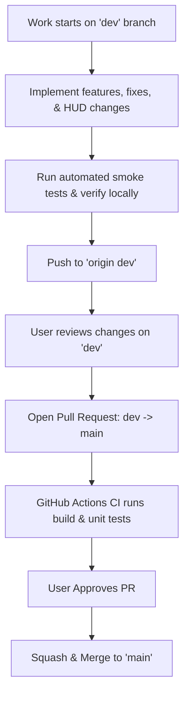

# Rule: Streamlined Git Branching & PR Governance

This rule governs version control strategy across PitWall OS to ensure clean repository history, prevent branch clutter, and maintain production stability on `main`.

---

## 1. Core Principles: No Branch Clutter

1. **No Micro-Branch Proliferation**:
   - **DO NOT** create a new numbered branch for every small issue or bugfix (e.g. no `fix-1`, `fix-2`, `issue-123`).
   - Minor bugfixes, telemetry tweaks, styling updates, and iterative enhancements happen directly on the active development branch (`dev`).
2. **Two Primary Long-Lived Branches**:
   - **`main`** *(Production / Golden Copy)*:
     - Always stable, fully tested, and deployable.
     - Never push unverified code directly to `main`.
   - **`dev`** *(Active Development & Staging)*:
     - The daily workspace where features, fixes, and improvements accumulate and are tested together.
3. **Dedicated Milestone Branches (Optional & Ephemeral)**:
   - Only create a separate branch when initiating a **major, self-contained multi-day sprint** (e.g., `sprint-5-audio-radio`).
   - Once the sprint is verified, it merges back into `dev` and the temporary branch is **immediately deleted**.

---

## 2. The Development & PR Flow



---

## 3. Standard Operating Procedures (SOP)

### Starting a New Session / Work Stream
1. Ensure `dev` is up to date with `main`:
   ```bash
   git checkout dev
   git merge main
   ```
2. Build, test, and iterate on `dev`.

### Committing Changes on `dev`
1. Present the diff summary to the user:
   - State clearly which files were modified and what was fixed.
2. Request explicit user approval before executing `git commit`.

### Releasing to `main` via PR
1. Verify all smoke tests pass (`npm run build`, backend `/api/v1/health`, OTel spans).
2. Push `dev` to remote:
   ```bash
   git push origin dev
   ```
3. Open a Pull Request from `dev` into `main`.
4. Upon user approval, merge the PR into `main`.
