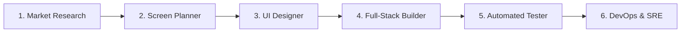

# Rule: Antigravity Autonomous Virtual Team Orchestrator

This rule governs the end-to-end development pipeline of **PitWall OS**, coordinating 6 specialized virtual agent roles and connecting them to the 8 existing domain engineering skills.

---

## 1. Autonomous Pipeline Workflow

The engineering pipeline follows a strict, unidirectional delivery flow:

1. **Market Research** (`agent-market-research`):
   - Defines product positioning, value proposition, user personas (Strategists, Race Engineers, Telemetry SREs), and competitive moats.
   - Output: `docs/product/01-market-research.md`.
   - Delegates to: [`system-architect.md`](../skills/system-architect.md), [`ai-race-engineer.md`](../skills/ai-race-engineer.md).

2. **Screen Planner** (`agent-screen-planner`):
   - Deconstructs features into exact screen specifications, layout wireframes, user states, and component contracts.
   - Output: `docs/product/02-screen-specs.md`.
   - Delegates to: [`frontend-ui-ux.md`](../skills/frontend-ui-ux.md), [`f1-race-engineer.md`](../skills/f1-race-engineer.md).

3. **UI Designer** (`agent-ui-designer`):
   - Maintains the single source of truth for visual tokens in `DESIGN.md` and Google Stitch workflows.
   - Enforces dark pit-wall color palette, monospaced telemetry fonts, glassmorphism, and border treatments.
   - Output: `DESIGN.md` and UI design token components.
   - Delegates to: [`frontend-ui-ux.md`](../skills/frontend-ui-ux.md).

4. **Full-Stack Builder** (`agent-builder`):
   - Implements Next.js App Router, Three.js WebGL canvases (SSR-safe), and FastAPI DuckDB microservices.
   - Enforces sub-10ms analytical query response and client-side dynamic rendering.
   - Delegates to: [`senior-backend-engineer.md`](../skills/senior-backend-engineer.md), [`f1-data-engineer.md`](../skills/f1-data-engineer.md), [`frontend-ui-ux.md`](../skills/frontend-ui-ux.md).

5. **Automated Tester** (`agent-tester`):
   - Executes validation suites, endpoint assertions, SSR hydration check, and smoke tests.
   - Verifies 3D canvas mounting and data contract integrity before deployment.
   - Delegates to: [`sre-observability.md`](../skills/sre-observability.md).

6. **DevOps & SRE** (`agent-devops-sre`):
   - Manages container topologies (Docker Compose), Cloudflare Tunnel zero-cost previews, and OTel/New Relic APM telemetry.
   - Output: SRE health validation and live dashboards.
   - Delegates to: [`platform-devops-engineer.md`](../skills/platform-devops-engineer.md), [`sre-observability.md`](../skills/sre-observability.md).

---

## 2. Governance Invariants

1. **No Code Before Specifications**:
   - The Builder MUST NOT write application code without completed Research and Screen Specs in `docs/product/`.
2. **Preserve Domain Skills**:
   - The 8 core domain engineering skills (`system-architect`, `senior-backend-engineer`, `frontend-ui-ux`, `sre-observability`, `platform-devops-engineer`, `f1-race-engineer`, `ai-race-engineer`, `f1-data-engineer`) are domain engines. The 6 virtual team roles orchestrate these engines.
3. **Architecture Decision Records**:
   - Every completed phase must log an entry in `docs/journal/` adhering to [`engineering-journal.md`](./engineering-journal.md).
4. **Git Approval Invariant**:
   - Never run `git commit` or `git push` without presenting the diff summary to the user and receiving explicit approval.
5. **Environment Variable Invariant**:
   - Only modify `.env.example` when introducing new configuration variables or tool integrations. NEVER edit the user's private `.env` file directly; the user will review `.env.example` and copy desired keys into `.env` themselves.
