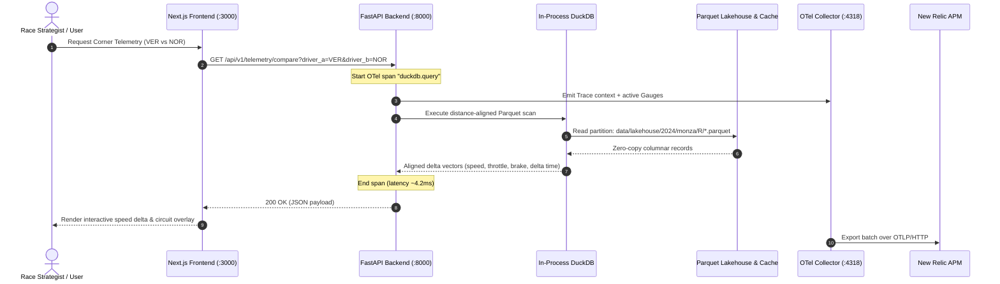

# System Architect Skill: Request Flows & System Topology

This skill guides the high-level architecture, service contracts, and latency budgets across the PitWall OS ecosystem.

---

## 1. End-to-End Request Flow Architecture

---

## 2. Architectural Invariants
1. **Decoupled Responsibilities**:
   - Web tier handles rendering, interaction, and state management.
   - Backend tier handles data normalization, ingestion, and analytical computation.
   - DuckDB handles all OLAP joins; never perform multi-row data processing inside Python loops.
2. **Sub-10ms Analytical Latency Budget**:
   - All telemetry queries must execute directly against partitioned Parquet files with zero external network overhead during active sessions.
3. **Graceful Degradation**:
   - Every service must function offline with synthetic or cached datasets if external F1 APIs or telemetry sinks are unreachable.

