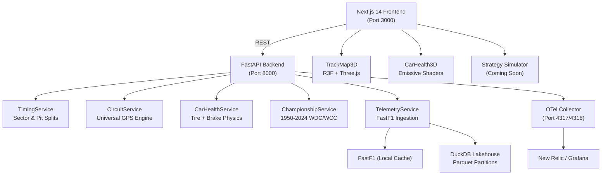

<div align="center">

# 🏎️ PitWall OS

### Formula 1 AI Telemetry, Vehicle Dynamics & Strategy Intelligence Hub

[](https://python.org)
[](https://fastapi.tiangolo.com)
[](https://nextjs.org)
[](https://threejs.org)
[](https://duckdb.org)
[](https://docker.com)
[](https://opentelemetry.io)
[](LICENSE)

**A zero-cost, production-grade F1 strategy intelligence platform for teams, analysts, and engineers.**

[Features](#-features) · [Architecture](#-architecture) · [Quick Start](#-quick-start) · [API Reference](#-api-reference) · [Engineering Journal](#-engineering-journal) · [Roadmap](#-roadmap)

---

</div>

## 🎯 What is PitWall OS?

PitWall OS is a **B2B Formula 1 strategy intelligence platform** that ingests, processes, and visualises real-world F1 telemetry data — entirely free of any commercial API licensing. Built for engineers, race strategists, and performance analysts who want to move beyond spreadsheets.

> **"The gap between P1 and P3 is decided on the pit wall — PitWall OS puts a supercomputer on every strategist's desk."**

### Who is this for?

| User | Use Case |
|---|---|
| 🏁 **Race Strategists** | Undercut/overcut window analysis, tire cliff prediction, safety car probability |
| 📊 **Performance Engineers** | Sector-by-sector delta, brake thermal modelling, grip state machine |
| 🎓 **F1 Analysts & Researchers** | 1950–2024 WDC/WCC historical data, DuckDB lakehouse for custom SQL analytics |
| 🛠️ **Developers** | Full-stack F1 data platform to extend with your own models and ML pipelines |

---

## ✨ Features

### 🔴 Live Telemetry & Lap Analysis
- **FastF1 ingestion** with local SQLite + Parquet caching — no repeated API hits
- Per-lap telemetry channels: Speed, Throttle, Brake, Gear, DRS, RPM, ERS
- **1-metre distance resampling** for alignment across drivers and stints

### 🌐 Universal 3D Circuit Engine
- Dynamic circuit geometry for **any Grand Prix** via `FastF1.get_circuit_info()`
- Real GPS track coordinates rotated to standard map orientation
- **3D WebGL ribbon** with `CatmullRomCurve3` spline extrusion (Three.js / React Three Fiber)
- Vertex-coloured sectors: Cyan (S1), Amber (S2), Purple (S3)
- Interactive 3D corner pins for **every turn** on every circuit

### 🛞 Vehicle Health & Tire Physics
- **4-wheel grip state machine**: OPTIMAL → DEGRADING → GRIP_LOST
- Wear % calculated from stint age, cornering G-load, and lap delta decay
- **Brake disc thermal model**: heat accumulation under hard braking events (>80% pedal, >200 km/h), radiative cooling on straights
- Clutch engagement slip detection for standing starts and pit-exit events
- Emissive 3D shader: Cyan ✅ | Amber ⚠️ | Pulsing Red 🔴 — per wheel corner

### ⏱️ Sector & Pit Stop Analytics
- Sector 1 / 2 / 3 split times per lap per driver
- Purple (overall fastest) and green (personal best) sector flagging
- Pit stop duration, in-lap time, out-lap penalty, and tire compound change detection

### 🏆 Championship Intelligence Hub
- **1950–2024 World Drivers' Championship** — year-by-year full standings
- **Constructors' Championship** — all seasons
- Multi-season comparison view: "In which year did Hamilton finish P3?"

### 📦 DuckDB Analytical Lakehouse
- Zero-copy in-process SQL over Parquet partitions
- Schema: `data/lakehouse/{year}/{circuit}/{session}/{driver}.parquet`
- Write via DuckDB native C++ Parquet engine — no PyArrow dependency

### 📡 OpenTelemetry Observability
- Every API route, service method, and FastF1 call wrapped in explicit OTel spans
- OTLP exporter compatible with **New Relic, Grafana Tempo, Jaeger** (free tier)
- Collector: `otel/opentelemetry-collector-contrib`

---

## 🏗️ Architecture

```
┌─────────────────────────────────────────────────────────┐
│                    PitWall OS Stack                      │
├─────────────┬───────────────────────┬───────────────────┤
│  Frontend   │       Backend         │   Observability   │
│  Next.js 14 │   FastAPI / Python    │   OTel Collector  │
│  Three.js   │   FastF1 Ingestion    │   → New Relic     │
│  R3F / Drei │   DuckDB Lakehouse    │   → Grafana Tempo │
│  Tailwind   │   SQLite Cache        │   → Jaeger (local)│
└──────┬──────┴──────────┬────────────┴───────────────────┘
       │                 │
       │   REST/JSON     │
       └────────────────►│◄──── FastF1 (cached local disk)
                         │◄──── Parquet (data/lakehouse/)
                         │◄──── SQLite  (data/fastf1_cache/)
```



---

## 📁 Project Structure

```
formula 1/
├── backend/
│   ├── app/
│   │   ├── api/
│   │   │   ├── dashboard_router.py     # Telemetry & health endpoints
│   │   │   ├── circuits_router.py      # Circuit geometry endpoint
│   │   │   └── championship_router.py  # WDC/WCC historical data
│   │   ├── services/
│   │   │   ├── telemetry.py            # FastF1 ingestion + DuckDB writer
│   │   │   ├── circuit_service.py      # Universal 3D circuit geometry engine
│   │   │   ├── timing_service.py       # Sector splits & pit stop analytics
│   │   │   ├── car_health.py           # Tire grip & brake thermal model
│   │   │   └── championship.py         # Historical standings data
│   │   ├── db/
│   │   │   └── duckdb_client.py        # In-process DuckDB zero-copy queries
│   │   └── main.py                     # FastAPI app + OTel init
│   ├── requirements.txt
│   └── Dockerfile
├── frontend/
│   ├── src/
│   │   ├── app/
│   │   │   └── page.tsx                # Main dashboard page
│   │   ├── components/
│   │   │   ├── 3d/
│   │   │   │   ├── TrackMap3D.tsx      # 3D circuit ribbon + corner pins
│   │   │   │   └── CarHealth3D.tsx     # 3D car HUD with emissive shaders
│   │   │   ├── TrackMap.tsx            # 2D SVG circuit fallback
│   │   │   └── CarHealthHUD.tsx        # 2D car health dashboard
│   │   └── lib/
│   │       └── api.ts                  # API client types & fetch helpers
│   ├── public/models/
│   │   ├── f1_car.glb                  # 14MB low-poly F1 chassis (GLTF)
│   │   └── manifest.json
│   ├── package.json
│   └── Dockerfile
├── data/
│   ├── lakehouse/                      # Parquet partitions (git-ignored)
│   │   └── {year}/{circuit}/{session}/{driver}.parquet
│   └── fastf1_cache/                   # FastF1 HTTP + session cache (git-ignored)
├── docs/
│   └── journal/
│       ├── README.md                   # Journal index
│       ├── BUG-FIXES.md               # Incident & fix log
│       ├── 001-*.md                    # Sprint 1 journal
│       ├── ...
│       └── 007-universal-3d-circuits-and-car.md
├── .agents/
│   └── rules/
│       ├── architecture.md             # Zero-cost & caching invariants
│       ├── sre-opentelemetry.md        # OTel span requirements
│       └── engineering-journal.md      # Documentation mandates
├── otel-collector-config.yaml
├── docker-compose.yml
├── .env.example
└── README.md
```

---

## 🚀 Quick Start

### Prerequisites
- [Docker](https://docs.docker.com/get-docker/) & Docker Compose v2+
- Git

### 1. Clone the repository

```bash
git clone https://github.com/YOUR_USERNAME/pitwall-os.git
cd "pitwall-os"
```

### 2. Configure environment variables

```bash
cp .env.example .env
# Edit .env — all fields have safe defaults for local development
```

### 3. Launch all services

```bash
docker compose up --build
```

| Service | URL | Description |
|---|---|---|
| **Frontend** | http://localhost:3000 | Next.js 14 dashboard |
| **Backend API** | http://localhost:8000 | FastAPI + Swagger UI at `/docs` |
| **OTel Collector** | localhost:4317 / 4318 | OTLP gRPC / HTTP receiver |

> **First run note:** FastF1 will download session data for un-cached circuits (15–60s). Subsequent requests are instant from local disk cache.

### 4. Load your first circuit

```bash
# Fetch Monza 2024 circuit geometry
curl "http://localhost:8000/api/v1/circuits/2024/monza/geometry"

# Load Verstappen vs Norris telemetry (Monza Race)
curl "http://localhost:8000/api/v1/telemetry/VER/NOR?year=2024&circuit=monza&session=R"
```

---

## ⚙️ Environment Variables

Copy `.env.example` to `.env`. All variables have working defaults for local development.

```dotenv
# OpenTelemetry — New Relic OTLP (leave blank for local Jaeger/Grafana)
NEW_RELIC_LICENSE_KEY=

# FastF1 — F1 account (optional; falls back to livetiming-mirror.fastf1.dev)
FF1_EMAIL=
FF1_PASSWORD=

# DuckDB lakehouse base path
LAKEHOUSE_PATH=./data/lakehouse

# FastF1 cache path
FF1_CACHE_PATH=./data/fastf1_cache
```

---

## 📡 API Reference

### Circuit Geometry

| Method | Endpoint | Description |
|---|---|---|
| `GET` | `/api/v1/circuits/{year}/{circuit}/geometry` | Full 3D spline, corners, sector distances |

**Response:**
```json
{
  "circuit_name": "Monza",
  "track_length_meters": 5793,
  "spline_points": [[x, y, z], ...],
  "sectors": { "s1_end_dist": 1420, "s2_end_dist": 3890, "s3_end_dist": 5793 },
  "corners": [{ "number": 1, "x": 12.4, "y": 0.5, "z": -4.2, "distance": 1120, "angle": 85.0 }]
}
```

### Telemetry

| Method | Endpoint | Description |
|---|---|---|
| `GET` | `/api/v1/telemetry/{driver1}/{driver2}` | Side-by-side lap telemetry |
| `GET` | `/api/v1/telemetry/{driver}/health` | 4-wheel tire wear, brake temp, clutch |
| `GET` | `/api/v1/sessions/{session_id}/sectors` | Sector splits + pit stop timings |

### Vehicle Health

| Method | Endpoint | Description |
|---|---|---|
| `GET` | `/api/v1/telemetry/{driver}/health` | Tire grip state, brake disc temp, status hex |

**Response:**
```json
{
  "tires": {
    "FL": { "wear_pct": 82.3, "status": "GRIP_LOST", "color": "#ef4444" },
    "FR": { "wear_pct": 58.1, "status": "DEGRADING",  "color": "#f59e0b" },
    "RL": { "wear_pct": 31.0, "status": "OPTIMAL",    "color": "#10b981" },
    "RR": { "wear_pct": 29.5, "status": "OPTIMAL",    "color": "#10b981" }
  },
  "brakes": { "FL_temp": 720, "FR_temp": 685, "status": "HOT" },
  "clutch": { "status": "NOMINAL", "slip_pct": 0.0 }
}
```

### Championship

| Method | Endpoint | Description |
|---|---|---|
| `GET` | `/api/v1/championship/drivers/{year}` | WDC standings for a given season |
| `GET` | `/api/v1/championship/constructors/{year}` | WCC standings for a given season |
| `GET` | `/api/v1/championship/drivers` | All seasons (1950–2024) |

---

## 🛞 Vehicle Dynamics Model

### Tire Grip State Machine

```
Wear %:    0% ──────── 50% ──────── 75% ──────── 100%
Status:   OPTIMAL       DEGRADING        GRIP_LOST
Color:    #10b981       #f59e0b          #ef4444
3D Glow:  Cyan (0.5)    Amber (1.5)      Red pulse (2.5)
```

**Wear formula:**
$$W_{corner} = W_{stint\_age} \cdot k_{compound} + G_{lateral} \cdot k_{cornering} + \Delta_{lap} \cdot k_{cliff}$$

### Brake Disc Thermal Model

$$T_{brake}^{(t+1)} = T_{brake}^{(t)} + \Delta T_{decel} \cdot \mathbb{1}[\text{Brake} > 80\%, v > 200] - \lambda_{cool} \cdot (T_{brake}^{(t)} - T_{ambient})$$

---

## 📓 Engineering Journal

All sprints, architectural decisions, and bug fixes are documented in [`docs/journal/`](docs/journal/).

| Entry | Sprint | Description |
|---|---|---|
| [001](docs/journal/) | Sprint 1 | Project scaffolding, FastF1 ingestion, DuckDB lakehouse |
| [002](docs/journal/) | Sprint 2 | Next.js dashboard, championship hub, B2B strategy simulator |
| [003](docs/journal/) | Sprint 3 | Sector timing, pit stop analytics, vehicle health state machine |
| [004](docs/journal/) | Sprint 3b | Three.js / R3F 3D WebGL integration |
| [007](docs/journal/007-universal-3d-circuits-and-car.md) | Sprint 4 | Universal circuit engine, 3D corner pins, emissive car HUD |
| [BUG-FIXES](docs/journal/BUG-FIXES.md) | All | Incident log & post-mortems |

---

## 🗺️ Roadmap

### ✅ Completed
- [x] FastF1 telemetry ingestion with zero-repeat caching
- [x] DuckDB Parquet lakehouse
- [x] Universal 3D circuit engine (any Grand Prix)
- [x] 3D WebGL track ribbon with sector colouring
- [x] Dynamic corner pins for every turn
- [x] 4-wheel tire grip state machine + brake thermal model
- [x] 3D car HUD with emissive shaders
- [x] Championship hub (1950–2024 WDC/WCC)
- [x] OpenTelemetry instrumentation

### 🔄 In Progress
- [ ] **Sprint 5: AI Race Engineer** — natural language strategy debriefs over DuckDB (LLM tool-calling)
- [ ] **Sprint 6: Monte Carlo Strategy Simulator** — 10,000-run stochastic sim, undercut/overcut windows, safety car probability

### 🔮 Future
- [ ] Live timing WebSocket feed (OpenF1 streaming)
- [ ] Driver comparison ML model (sector clustering)
- [ ] Automated stint debrief report generation (PDF export)
- [ ] Multi-year team budget cap analysis

---

## 🤝 Contributing

Contributions are welcome! Before opening a PR:

1. Read the rules in [`.agents/rules/`](.agents/rules/) — especially `architecture.md` (zero-cost caching invariant) and `engineering-journal.md` (all changes need a journal entry).
2. Add or update the relevant journal entry in `docs/journal/`.
3. All new service methods must carry an explicit OpenTelemetry span (`sre-opentelemetry.md`).
4. Use [Conventional Commits](https://www.conventionalcommits.org/): `feat`, `fix`, `docs`, `chore`, `perf`.

```bash
# Run backend tests
cd backend && python -m pytest

# Run frontend type-check
cd frontend && npm run type-check
```

---

## 📜 License

This project is licensed under the **MIT License** — see [LICENSE](LICENSE) for details.

F1 telemetry data is provided by [FastF1](https://github.com/theOehrly/Fast-F1) and the [OpenF1 API](https://openf1.org/), which source data from the FIA live timing feed. This project is not affiliated with or endorsed by Formula 1, the FIA, or any F1 team.

---

<div align="center">

Built with ❤️ for the F1 engineering community

**[⬆ Back to top](#️-pitwall-os)**

</div>

