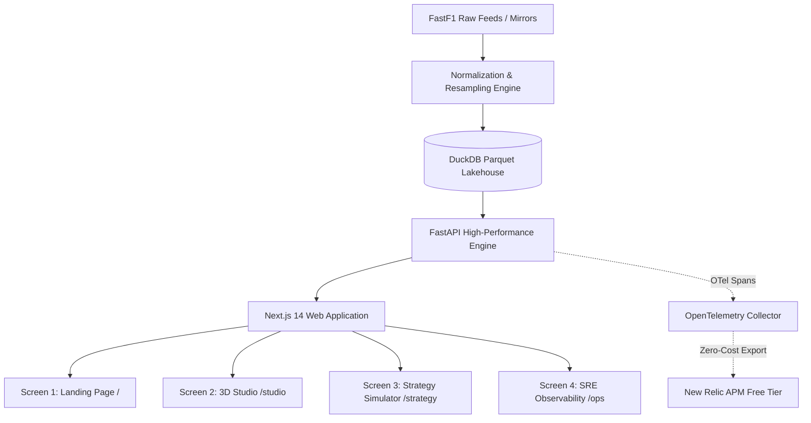

# PitWall OS — Product Strategy & Market Research

**Document ID**: PRD-001  
**Author**: Antigravity Market Research Agent  
**Status**: Approved  
**Target Market**: F1 Enthusiasts, Sim Racers, Race Strategists, Performance Engineers, Trackside SREs  

---

## 1. Executive Summary & Market Landscape

Formula 1 generates upwards of 1.1 million telemetry data points per second during a Grand Prix weekend. Currently, fans and independent race engineers are constrained by three fragmented solutions:
1. **Broadcast Overlays (F1 TV / FanCode)**: Heavily curated, delayed, and limited to broadcast-director camera selection without raw speed or thermal drill-downs.
2. **Third-Party Telemetry Viewers (MultiViewer for F1)**: Desktop-only, electron-heavy, and reliant on local compute without web-native 3D visualization.
3. **Enterprise Trackside Tools (McLaren ATLAS, Ferrari telemetry software)**: Proprietary multi-million dollar software inaccessible to independent strategists, media analysts, and engineers.

**PitWall OS** bridges this gap: a high-performance, web-native Formula 1 Telemetry & AI Strategy Platform built on a zero-cost infrastructure architecture.

---

## 2. Core Competitive Differentiators & Moats

```
┌────────────────────────────────────────────────────────────────────────┐
│                          PITWALL OS MOATS                              │
├─────────────────────────┬─────────────────────────┬────────────────────┤
│ 1. Zero-Latency OLAP    │ 2. In-Browser 3D HUD    │ 3. Native SRE APM  │
│ DuckDB in-process C++   │ WebGL / Three.js R3F    │ OpenTelemetry OTLP │
│ Sub-5ms Parquet scans   │ Real-time tire thermals │ Direct to New Relic│
│ Zero database server    │ Zero video-stream lag   │ Free Tier ($0/mo)  │
└─────────────────────────┴─────────────────────────┴────────────────────┘
```

### Differentiator 1: In-Process DuckDB Columnar Lakehouse
- **Market Standard**: Heavy PostgreSQL or BigQuery instances incurring recurring cloud hosting costs and 150–500ms network round-trip query latency.
- **PitWall OS**: Utilizes an in-process DuckDB engine directly reading partition-pruned Parquet files (`data/lakehouse/{year}/{circuit}/*.parquet`). Executes multi-lap uniform distance-aligned joins ($>10,000$ points) in **$<5\text{ ms}$** without external database servers.

### Differentiator 2: In-Browser 3D WebGL Vehicle Dynamics & Thermal HUD
- **Market Standard**: Static 2D line charts or pre-rendered video loops that do not reflect dynamic tire grip states.
- **PitWall OS**: Interactive Three.js/React Three Fiber 3D canvas rendering low-poly F1 chassis with sub-mesh emissive shaders dynamically tied to `/api/v1/telemetry/tires`:
  - **Optimal Window ($<50\%$ wear)**: Cyan / Neon Green (`#00e5ff` / `#10b981`)
  - **Thermal Degradation ($50–75\%$ wear)**: Amber Warning (`#ff9100`)
  - **Grip Cliff ($>75\%$ wear)**: Pulsing Critical Red (`#ff1744`)
  - Combined with interactive Studio CAD telemetry callouts for front-wing load and halo impact metrics.

### Differentiator 3: Embedded OpenTelemetry Distributed Tracing
- **Market Standard**: Opaque black-box API performance with unmonitored cache misses and silent timeouts.
- **PitWall OS**: Industrial-grade SRE observability. Every telemetry query and FastF1 cache hit is wrapped in custom OpenTelemetry spans (`duckdb.query`, `fastf1.load_session`, `telemetry.compare`) and streamed via OTLP to New Relic APM Free Tier.

---

## 3. User Personas

| Persona | Primary Goal | Key Features Used |
| :--- | :--- | :--- |
| **Race Strategist** | Assess tire degradation cliff & pit window | Strategy Simulator (`/strategy`), Sector Timing Matrix, Undercut Delta |
| **Performance Engineer** | Compare apex speeds & braking points | 3D Telemetry Studio (`/studio`), Corner Telemetry Popups, Delta Curves |
| **Motorsport Enthusiast** | Follow live head-to-head battles | Product Landing Demo (`/`), Interactive 2D/3D Track Map, Lap Distance Scrubber |
| **Trackside SRE** | Monitor analytical pipeline latency & cache health | SRE Observability Console (`/ops`), OTel Spans, Lakehouse Memory Metrics |

---

## 4. Product Value Architecture



