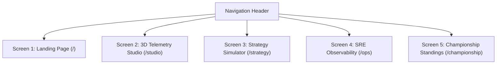

# PitWall OS — Screen Specifications & Architecture

**Document ID**: PRD-002  
**Author**: Antigravity Screen Planner Agent  
**Status**: Approved  
**Related Rule**: [`.agents/rules/team-orchestrator.md`](../../.agents/rules/team-orchestrator.md)  

---

## 1. Application Screen Topology

---

## 2. Detailed Screen Specifications

### Screen 1: Product Landing Page (`/`)
- **Route**: `frontend/src/app/page.tsx`
- **Purpose**: Showcase platform capabilities, architecture moats, and live simulated telemetry deltas to convert visitors into active console users.
- **Key Sections**:
  1. **Hero Section**:
     - Headline: `"PitWall OS // Enterprise F1 Telemetry & AI Strategy Platform"`
     - Subheadline: Real-time head-to-head telemetry analysis, 3D vehicle thermal dynamics, in-process DuckDB queries, and embedded OpenTelemetry tracing.
     - Call to Action Buttons:
       - `[ Launch Telemetry Studio ]` $\to$ links to `/studio`
       - `[ Live SRE Metrics ]` $\to$ links to `/ops`
       - `[ Simulate Pit Strategy ]` $\to$ links to `/strategy`
  2. **Live Interactive Telemetry Delta Demo Card**:
     - Interactive preview showcasing simulated real-time telemetry comparison between **Lewis Hamilton (HAM)** and **Charles Leclerc (LEC)** at Monza.
     - Interactive scrubber adjusting simulated lap distance, updating speed deltas, throttle trace, and brake pressure in real-time.
  3. **Architecture & Moats Grid**:
     - 4 high-contrast cards highlighting DuckDB columnar lakehouse ($<5\text{ms}$ joins), 3D WebGL car thermals, OTel distributed tracing, and zero-cost cloud topology.
  4. **Circuit Availability Ticker**:
     - List of 8 ready-to-analyze Grand Prix circuits (Monza, Silverstone, Spa, Suzuka, Monaco, Red Bull Ring, Zandvoort, Interlagos).

---

### Screen 2: 3D Telemetry Studio (`/studio`)
- **Route**: `frontend/src/app/studio/page.tsx`
- **Purpose**: The operational nerve center for race engineers and fans.
- **Key Components**:
  1. **Circuit & Driver Selector Header**:
     - Circuit dropdown (Austria, Monza, Silverstone, Spa, Suzuka, Monaco, etc.).
     - Driver A vs Driver B selector (VER vs NOR, HAM vs LEC).
     - Live Strategy Badges: Top Speed Delta, Apex Speed Delta, Brake Disc Thermal Window, Vehicle Grip State.
  2. **Primary Viewport (Dual 2D / 3D Mode)**:
     - **2D Broadcast Map (`TrackMap.tsx`)**: Authentic SVG track spline with exact corner tags (T1 to T8), sector colors (S1 Cyan, S2 Amber, S3 Purple), start/finish line, and live car beacons.
     - **3D Spline Track Ribbon (`TrackMap3D.tsx`)**: Extruded 3D tube geometry with elevation, interactive `<Html>` pins on every corner, camera focus animations, and apex speed cards.
  3. **Vehicle Health & Thermal HUD (`CarHealth3D.tsx`)**:
     - **Studio CAD View**: User-attached high-definition CAD render with precision callout badges attached to 4 tyres, front wing load ($-4.2\text{G}$), and halo load ($125\text{ kN}$).
     - **3D WebGL Mesh**: Three.js canvas with studio-grey carbon chassis and dynamic tire emissive materials tied to wear state ($<50\%$ Cyan, $50–75\%$ Amber, $>75\%$ Red).
  4. **Synchronous Telemetry Delta Charts (`TelemetryChart.tsx`)**:
     - Speed delta curve ($0–360\text{ km/h}$).
     - Throttle application percentage ($0–100\%$).
     - Brake pressure trace ($0–100\%$).
  5. **Sector Splits & Race Lap Matrix**:
     - Scrollable full race distance table (e.g. 71 laps for Austrian GP) with sector delta color-coding (purple fastest, green personal best, yellow normal) and pit stop indicators.

---

### Screen 3: Race Strategy Simulator (`/strategy`)
- **Route**: `frontend/src/app/strategy/page.tsx`
- **Purpose**: Monte Carlo tire wear modeling and pit stop delta evaluation.
- **Components**:
  - Tire degradation forecasting graph across Soft, Medium, and Hard compounds.
  - Undercut / overcut window predictor.
  - Virtual safety car (VSC) & full safety car delta savings calculator.

---

### Screen 4: SRE Observability Console (`/ops`)
- **Route**: `frontend/src/app/ops/page.tsx`
- **Purpose**: System reliability and infrastructure telemetry.
- **Components**:
  - Live OpenTelemetry span throughput and $P_{95} / P_{99}$ latency metrics.
  - DuckDB in-process memory footprint and partition scan duration.
  - New Relic OTLP export connection health.
  - Cloudflare Tunnel edge connectivity status.

