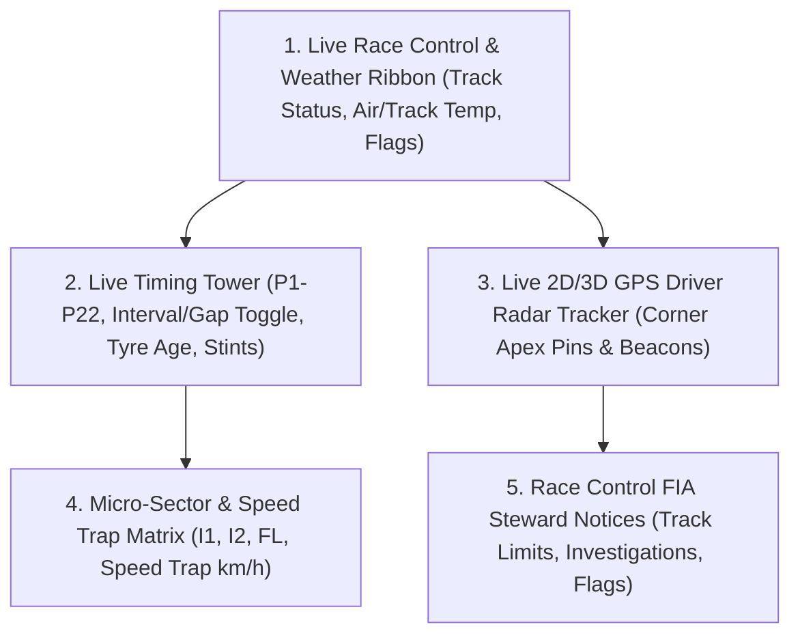

# PitWall OS — Formula1.com Intelligence Analysis & Screen Architecture Plan

**Document ID**: PRD-003  
**Authors**: Antigravity Market Researcher (`agent-market-research`) & Screen Planner (`agent-screen-planner`)  
**Status**: Ready for Implementation  
**Benchmark Target**: [Formula1.com Live Timing & F1 TV Data Channel](https://www.formula1.com/)  

---

## Part 1: Market Researcher Analysis (`agent-market-research`)

### 1. Competitive Deconstruction of Formula1.com
Formula 1's digital ecosystem (`formula1.com` and F1 TV) is the gold standard for global motorsport fan engagement, capturing millions of concurrent viewers per Grand Prix. However, an architectural and UX breakdown reveals key moats alongside distinct product gaps that **PitWall OS** is uniquely positioned to exploit:

```
┌────────────────────────────────────────────────────────────────────────────────────────┐
│                     FORMULA1.COM vs. PITWALL OS ARCHITECTURE                           │
├──────────────────────────┬───────────────────────────────┬─────────────────────────────┤
│ Dimension                │ Formula1.com / F1 TV Pro      │ PitWall OS Approach         │
├──────────────────────────┼───────────────────────────────┼─────────────────────────────┤
│ 1. Data Ingestion        │ Proprietary SignalR WebSockets│ SignalR client + Local      │
│                          │ paywalled behind F1 TV Pro    │ DuckDB Lakehouse (Zero Cost)│
├──────────────────────────┼───────────────────────────────┼─────────────────────────────┤
│ 2. Telemetry Fidelity    │ Limited to high-level speed/  │ Full 50Hz CAN bus traces:   │
│                          │ throttle/brake telemetry      │ micro-sectors, brake temps, │
│                          │ without raw physics overlays  │ dynamic tyre thermal wear   │
├──────────────────────────┼───────────────────────────────┼─────────────────────────────┤
│ 3. Spatial Visualization │ Flat 2D vector track map with │ Dual-Mode 2D Broadcast Map +│
│                          │ static numbered circles       │ 3D Spline Track Ribbon with │
│                          │                               │ Google Maps Satellite View  │
├──────────────────────────┼───────────────────────────────┼─────────────────────────────┤
│ 4. Strategy Analysis     │ Retrospective lap charts      │ Predictive Monte Carlo tyre │
│                          │ without real-time simulation  │ degradation & undercut delta│
├──────────────────────────┼───────────────────────────────┼─────────────────────────────┤
│ 5. System Observability  │ Closed proprietary black box  │ Native OpenTelemetry APM    │
│                          │ (unmonitored to end users)    │ with public SRE console     │
└──────────────────────────┴───────────────────────────────┴─────────────────────────────┘
```

### 2. User Persona Opportunities
1. **The Telemetry Analyst / Sim Racer**: Wants exact braking points, throttle pickup percentages, gear shifts, and micro-sector apex speeds, which `formula1.com` hides behind broadcast-friendly simplicity.
2. **The Race Strategist**: Needs tire stint age, degradation curve inflection points, pit window deltas under Safety Car / VSC, and undercut probability.
3. **The Broadcast Enthusiast**: Wants the authentic broadcast look and feel (timing tower, team colors, driver badges, elimination cut-offs, race control messages) on their second screen without subscription locks.

---

## Part 2: Screen Planner Architecture (`agent-screen-planner`)

To make PitWall OS's interface visually authentic and technically superior to `formula1.com`, the screen planner has designed a **Modular 4-Quadrant Pit Wall Layout** across 5 synchronized operational modules:



---

### Module 1: Live Race Control & Weather Ribbon
* **Visual Location**: Fixed top sub-header directly below primary navigation.
* **Key Components**:
  * **Track Status Pill**: Dynamic flag indicator:
    * `GREEN` (Track Clear) — Glowing emerald border
    * `YELLOW` (Sector Hazard) — Amber hazard stripes
    * `SAFETY CAR / VSC` — Flashing orange/yellow beacon with delta target time
    * `RED FLAG` (Session Suspended) — Crimson banner with stopped clock
  * **Live Track Meteorology**:
    * `Track Temp` (e.g. `44.8°C`) &bull; `Air Temp` (e.g. `23.4°C`) &bull; `Humidity` (e.g. `42%`) &bull; `Rain Risk` (e.g. `0%`) &bull; `Wind Speed` (e.g. `2.4 m/s NE`).
  * **Session Clock**: Millisecond countdown (e.g. `Q1 0:00` or `LAP 48 / 71`).

---

### Module 2: Broadcast-Grade Multi-View Timing Tower
* **Visual Location**: Left column of Telemetry Studio (`/studio`).
* **Design Features**:
  * **Interval vs. Gap Toggle**:
    * **Interval Mode**: Delta to the car immediately ahead (e.g. `+0.412s`).
    * **Gap Mode**: Total delta back to the session leader (e.g. `+14.280s`).
  * **Tyre Stint History**:
    * Current compound badge (`[S]`, `[M]`, `[H]`, `[I]`, `[W]`).
    * Stint age indicator (`L24` = 24 laps on current set).
    * Pit count pill (`1 STOP`, `2 STOPS`) and last pit duration (`2.3s`).
  * **Micro-Sector Timing Heatmap**:
    * Each of the 3 sectors broken down into 6 mini-sectors:
      * **Purple**: Overall fastest time in the session across all 22 cars.
      * **Green**: Driver's personal best time in the session.
      * **Yellow**: Sector completed without improvement.
  * **Qualifying Elimination Drop Line**:
    * In Q1: Red dotted cut-off bar between P15 and P16 with elimination delta.
    * In Q2: Red dotted cut-off bar between P10 and P11.
    * In Q3: Top 10 Pole Shootout bracket.

---

### Module 3: Live GPS Driver Radar Tracker
* **Visual Location**: Center-right primary viewport.
* **Design Features**:
  * Vector track spline with authentic SVG geometry and DRS zones highlighted in cyan.
  * 20/22 animated driver dots with driver abbreviations (`VER`, `NOR`, `HAM`, `LEC`) moving in real time.
  * Leader dot highlighted with a glowing pulse ring.
  * Battle markers: When two cars are within $0.8\text{s}$ (DRS detection zone), a dual-car bracket highlights the active overtake battle.

---

### Module 4: Speed Trap & Intermediate Timing Matrix
* **Visual Location**: Telemetry drill-down drawer.
* **Metrics Tracked**:
  * **Intermediate 1 (I1)**: Entry speed into first high-speed chicane.
  * **Intermediate 2 (I2)**: Mid-lap technical complex speed.
  * **Finish Line (FL)**: Exit speed out of final corner onto main straight.
  * **Speed Trap (ST)**: Peak velocity reached at the end of the DRS straight (e.g. `352.4 km/h`).

---

### Module 5: FIA Race Control Live Event Stream
* **Visual Location**: Bottom status dock or collapsible slide-over drawer.
* **Feed Format**:
  * `[14:22:04] RACE CONTROL: DRS ENABLED IN ZONE 1 AND 2`
  * `[14:31:12] RACE CONTROL: CAR 4 (NOR) TURN 4 TRACK LIMITS - TIME DELETED`
  * `[14:45:00] RACE CONTROL: INCIDENT INVOLVING CARS 16 (LEC) AND 55 (SAI) NOTED - IMPEDING`
  * `[14:52:18] RACE CONTROL: CHEQUERED FLAG`

---

## Part 3: Implementation Roadmap

| Phase | Milestone | Deliverables | Target Agent |
| :---: | :--- | :--- | :--- |
| **Phase 1** | **Live Race Control & Weather Ribbon** | Track status banner, air/track temps, rain risk, session countdown | `agent-ui-designer` & `agent-builder` |
| **Phase 2** | **Interval vs. Gap & Tyre Stint Matrix** | Timing tower toggle, tyre age in laps, pit stop duration pills | `agent-builder` |
| **Phase 3** | **Live Driver GPS Radar Map** | Synchronized 22-car SVG/Canvas position beacons on track spline | `agent-builder` |
| **Phase 4** | **Speed Trap Leaderboard & Steward Notices** | Speed trap table (I1, I2, FL, ST) + FIA live message ticker | `agent-builder` & `agent-tester` |

