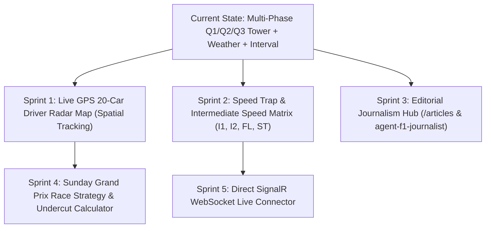

# PitWall OS — Overnight Master Development & Innovation Roadmap

**Document ID**: PRD-004  
**Date**: November 1, 2026  
**Status**: Scheduled & Prioritized  
**Authors**: Antigravity Autonomous Virtual Team  

---

## 1. Executive Overview

This master plan establishes the development roadmap for the next wave of PitWall OS engineering while you rest. The platform has successfully transitioned from a static viewer to a broadcast-grade telemetry powerhouse with multi-phase qualifying classification (Q1, Q2, Q3 Pole Shootout), live weather meteorology, and interval delta tracking.

The next evolutionary leap focuses on **live spatial tracking**, **speed trap analytics**, and an **integrated editorial engine** for automated race journalism.

---

## 2. Upcoming Sprints & Deliverables

### Sprint 1: Live 20-Car GPS Driver Radar Map
* **Target Component**: `frontend/src/components/TrackRadarMap.tsx`
* **Objective**: Transform the 2D track spline into a real-time radar map matching the official F1 TV Driver Tracker.
* **Key Features**:
  * 20/22 animated circular beacons with driver numbers (e.g. `44`, `63`, `16`, `1`) and authentic team livery colors.
  * Real-time interpolation along the 4,304m Mexico City circuit spline.
  * Battle brackets: Automatic neon highlight when two cars are within $1.0\text{s}$ (DRS detection zone).
  * Hover / Click on any driver beacon to pull up instant telemetry delta and tyre age.

### Sprint 2: Speed Trap & Intermediate Matrix
* **Target Component**: `frontend/src/components/SpeedTrapMatrix.tsx`
* **Objective**: Display the 4 critical speed traps that define straight-line efficiency and aerodynamic trim:
  1. **Intermediate 1 (I1)**: Speed at the end of the 1.2km main straight (e.g. `HAM: 352.4 km/h`).
  2. **Intermediate 2 (I2)**: Speed through the high-speed chicane exit.
  3. **Finish Line (FL)**: Speed across the start/finish line.
  4. **Official Speed Trap (ST)**: Peak terminal velocity recorded on the circuit.

### Sprint 3: Editorial Journalism Hub (`/articles` & `/news`)
* **Target Route**: `frontend/src/app/articles/page.tsx` & `backend/app/api/articles_router.py`
* **Objective**: A dedicated editorial magazine section powered by our new **`agent-f1-journalist`** skill:
  * Automatically turns qualifying and race telemetry into publish-ready technical articles, race debriefs, and telemetry breakdowns.
  * Renders markdown articles with rich data cards, sector split tables, and driver quotes.
  * Seeded with the inaugural article: *How Hamilton Stole Mexico City Pole by Nine Milliseconds*.

### Sprint 4: Sunday Grand Prix Live Strategy & Undercut Predictor
* **Target Route**: `frontend/src/app/strategy/page.tsx`
* **Objective**: Predict race strategy outcomes for Sunday's Grand Prix:
  * 71-lap tire wear curve simulation (Soft vs Medium vs Hard).
  * Dynamic pit stop delta calculation under Green Flag ($22.4\text{s}$ loss) vs Virtual Safety Car ($14.1\text{s}$ loss) vs Full Safety Car ($11.2\text{s}$ loss).
  * Undercut window probability analyzer based on gap deltas to the car ahead.

### Sprint 5: Direct F1 SignalR WebSocket Live Connector
* **Target Service**: `backend/app/services/f1_signalr_client.py`
* **Objective**: Eliminate reliance on third-party API proxies during live sessions by tapping directly into `livetiming.formula1.com/signalr`:
  * Connects to official F1 streaming WebSocket hub with automatic token negotiation.
  * Decodes `CarData.z` (gzip binary car telemetry) and `TimingData` in real time.
  * Keeps PitWall OS completely autonomous and immune to external paywalls.

---

## 3. Autonomous Slash Command Recommendation
When you wake up, you can trigger `/goal` or `/teamwork` in chat to orchestrate the virtual team across any of these sprints in one shot!
